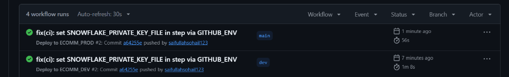
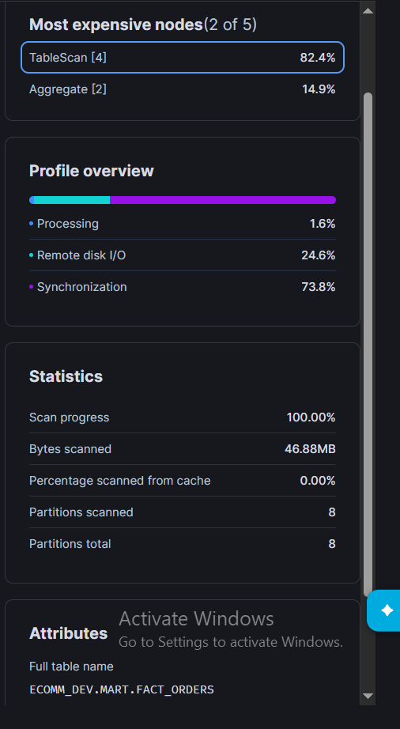
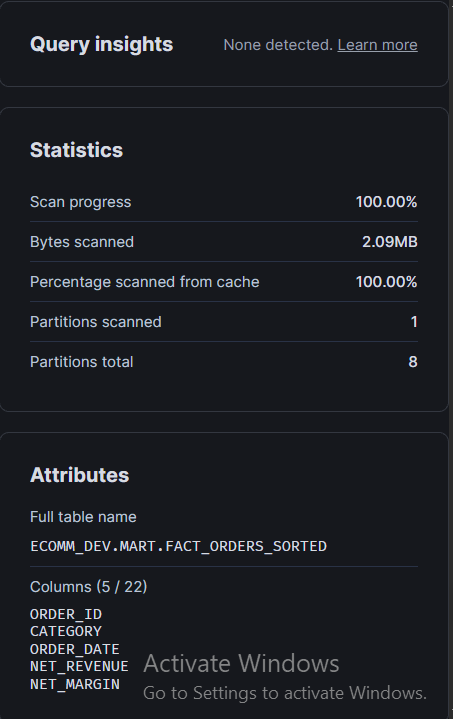
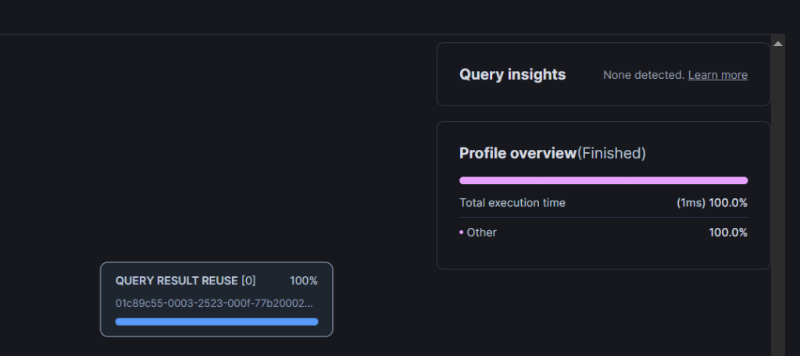

# Snowflake E-Commerce Analytics & Operations Platform

End-to-end **Snowflake + Streamlit in Snowflake (SiS)** analytics platform with automated **GitHub Actions CI/CD** (RSA key-pair auth via `TYPE = SERVICE` user), **Snowpark Python ETL**, and documented **micro-partition pruning & cost optimization benchmarks**.

---

## Architecture

```text
[Local Dev / Feature Branch]
         |
         v (push to `dev` or PR merge to `main`)
[GitHub Actions CI/CD] --(ruff + pytest + RSA Key-Pair Auth)--> [Snowflake CLI (`snow`)]
                                                                       |
              +--------------------------------------------------------+
              |                                                        |
              v                                                        v
   [SQL DDL & Ingestion]                                    [Streamlit in Snowflake]
   - Warehouses (ETL vs App)                                - Warehouse Runtime (`app/environment.yml`)
   - Least-Privilege RBAC                                   - Container Runtime (`pyproject.toml` ready)
   - Internal Stage -> COPY INTO -> RAW                     - `@st.cache_data(ttl=600)`
   - Snowpark Transforms -> MART                            - Reads ONLY from `MART` schema
   - Sorted / Clustered `FACT_ORDERS`                       - Parameterized `?` SQL queries
```

---

## Key Engineering Highlights

1. **Governance & Least-Privilege RBAC ([01_bootstrap_account.sql](sql/01_bootstrap_account.sql)):**
   - Isolated `X-SMALL` warehouses (`ECOMM_ETL_WH` for batch ingestion/ETL, `ECOMM_APP_WH` for interactive BI) with `AUTO_SUSPEND = 60` and `AUTO_RESUME = TRUE`.
   - Strict role separation: `ECOMM_APP_ROLE` has `SELECT` on `MART.*` (including future tables/views) and **zero access** to `RAW.*`.
   - Separate `ECOMM_DEV` and `ECOMM_PROD` databases.

2. **Bulk Ingestion & Snowpark ETL ([generate_data.py](scripts/generate_data.py), [run_snowpark_etl.py](scripts/run_snowpark_etl.py)):**
   - Vectorized Parquet generator scaling from 50k dev rows to 5M+ benchmark rows.
   - Staged bulk `COPY INTO` with `PARQUET_FF` (`USE_LOGICAL_TYPE = TRUE`) and `ON_ERROR = 'ABORT_STATEMENT'`.
   - Snowpark Session API transformations building `FACT_ORDERS` (with window-allocated order discounts/shipping), `DIM_CUSTOMERS`, `DIM_PRODUCTS`, `AGG_DAILY_REVENUE`, and `AGG_COHORT_RETENTION`.

3. **Portable Streamlit in Snowflake App ([app/](app/streamlit_app.py)):**
   - Runs identically inside SiS (`get_active_session()`) and locally (`st.connection("snowflake")`).
   - Four modular views: **Executive KPIs**, **Cohort Retention**, **Inventory & SKU Health**, and **Order Lookup**.
   - Every query uses `@st.cache_data(ttl=600)` and bound `?` parameters (tested against SQL injection in [test_queries.py](tests/test_queries.py)).
   - Configured for **Warehouse Runtime** (`app/environment.yml`) for trial compatibility, with **Container Runtime** (`pyproject.toml` / SPCS) documented in [snowflake.yml](snowflake.yml).

4. **Hands-Free CI/CD ([.github/workflows/](.github/workflows/)):**
   - `ci.yml`: Runs `ruff check`, `ruff format --check`, `pytest`, and repo/SQL security guardrails on PRs.
   - `deploy-dev.yml` / `deploy-prod.yml`: Authenticates as `SVC_GITHUB_CICD` (`TYPE = SERVICE`) via encrypted 2048-bit RSA key-pair (`SNOWFLAKE_JWT`), applies idempotent SQL migrations, and deploys the SiS app.

5. **Micro-Partition Pruning & Cost Proof ([docs/performance.md](docs/performance.md)):**
   - Benchmarked on **5,000,000 rows** in `ECOMM_DEV.MART.FACT_ORDERS` with `USE_CACHED_RESULT = FALSE`:
     - **Baseline (Unsorted):** `8 / 8` partitions scanned (`46.88 MB`, `664 ms`, `average_depth = 9.0`).
     - **Sorted (`ORDER BY ORDER_DATE, CATEGORY`):** `1 / 8` partitions scanned (**87.5% pruned**), `2.09 MB` scanned (**-95.5% I/O**), `210 ms`, `average_depth = 1.0`.
     - **Result Cache (`USE_CACHED_RESULT = TRUE`, 2nd run):** `0` partitions scanned, `0 B` warehouse I/O (`1 ms`).

---

## Screenshots & Verification Evidence

### Automated Multi-Environment CI/CD (`ECOMM_DEV` & `ECOMM_PROD`)


### Query Profile: Micro-Partition Pruning & Result Cache (5M Rows)

| Baseline (`FACT_ORDERS`: `8/8` partitions, `46.88 MB`) | Pruned (`FACT_ORDERS_SORTED`: `1/8` partitions, `2.09 MB`) | Result Cache (`QUERY RESULT REUSE`, `1 ms`) |
|---|---|---|
|  |  |  |

---

## Local Setup & Verification

```powershell
# 1. Activate Python 3.11 virtual environment & install dev dependencies
.\.venv\Scripts\Activate.ps1
uv pip install -e ".[dev]"

# 2. Run linter, formatter check, and unit tests
ruff check .
ruff format --check .
pytest -v

# 3. Run Streamlit app locally (requires .streamlit/secrets.toml)
streamlit run app/streamlit_app.py
```

See [plan.md](plan.md) and [docs/performance.md](docs/performance.md) for full architecture and benchmark details.

