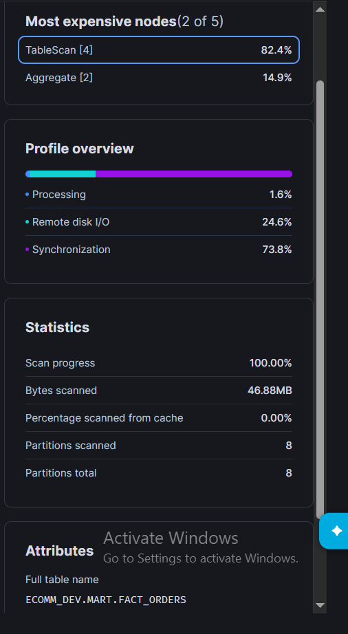
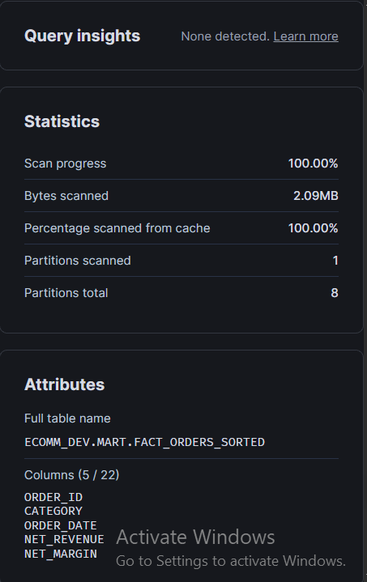
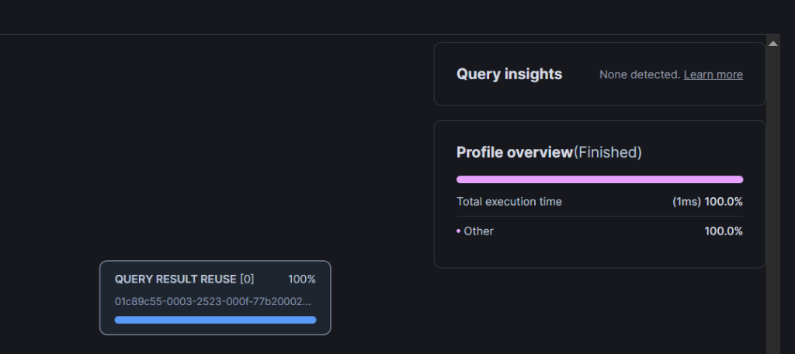

# Snowflake Micro-Partition Pruning & Cost Optimization Benchmark

## 1. Benchmark Setup

* **Table:** `ECOMM_DEV.MART.FACT_ORDERS` (~5,000,000 line-item rows, intentionally ingested unsorted)
* **Warehouse:** `ECOMM_APP_WH` (`X-SMALL`, `AUTO_SUSPEND = 60`)
* **Workload:** Selective 7-day window + single-category aggregation (`ORDER_DATE BETWEEN '2026-06-01' AND '2026-06-07' AND CATEGORY = 'Electronics'`)
* **Control:** `ALTER SESSION SET USE_CACHED_RESULT = FALSE` during Baseline and Sorted runs so Snowflake's 24-hour Result Cache does not mask storage I/O.

---

## 2. Before / After Results

| Metric | Baseline (Unsorted `FACT_ORDERS`) | Optimized (`ORDER BY ORDER_DATE, CATEGORY`) | Cached (`USE_CACHED_RESULT = TRUE`, 2nd run) |
|---|---|---|---|
| **Partitions Scanned** | `8` | `1` | `0 (Result Reuse)` |
| **Total Partitions** | `8` | `8` | `0` |
| **Partitions Pruned (%)** | `0.0%` (Full Scan) | `87.5%` | `100%` |
| **Bytes Scanned** | `46.88 MB` | `2.09 MB` (`-95.5%`) | `0 B` |
| **Execution Time** | `664 ms` | `210 ms` (`-68.4%`) | `1 ms (Result Reuse)` |

---

## 3. Clustering Health (`SYSTEM$CLUSTERING_INFORMATION`)

* **Baseline (`FACT_ORDERS`):**
  * `average_overlaps`: `8.0`
  * `average_depth`: `9.0`
* **Sorted (`FACT_ORDERS_SORTED`):**
  * `average_overlaps`: `0.0`
  * `average_depth`: `1.0`

---

## 4. Query Profile Evidence

### Baseline (Full / Near-Full Scan)

### Sorted / Clustered (Pruned Scan)

### 24-Hour Result Cache Reuse

---

## 5. Architectural Cost Rationale

1. **Why Batch Sorting (`ORDER BY`) Beats Automatic Clustering Below ~1 TB:**
   Snowflake's automatic clustering runs background serverless compute and bills credits continuously as data mutates. For analytical tables rebuilt or appended in batch (and under ~1 TB), sorting by `(ORDER_DATE, CATEGORY)` inside the ETL write achieves near-ideal micro-partition min/max metadata (`average_depth ≈ 1.0`) at **zero** ongoing serverless reclustering cost.
2. **Why `DIM_PRODUCTS` and `DIM_CUSTOMERS` Are Never Auto-Clustered:**
   Small dimension tables (`DIM_PRODUCTS` = 250 rows, fitting inside a single 16 MB micro-partition) cannot be pruned further—enabling `CLUSTER BY` on them adds metadata/reclustering overhead with zero scan reduction.
3. **Two-Layer Defense Against Unnecessary Warehouse Wakeups:**
   Pre-aggregated `MART.AGG_DAILY_REVENUE` + Streamlit `@st.cache_data(ttl=600)` prevents interactive filter toggles from even hitting `FACT_ORDERS`, while Snowflake's 24-hour Result Cache serves identical queries from Cloud Services without waking `ECOMM_APP_WH`.

